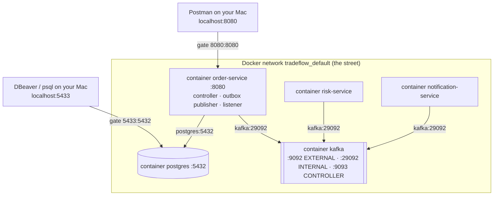
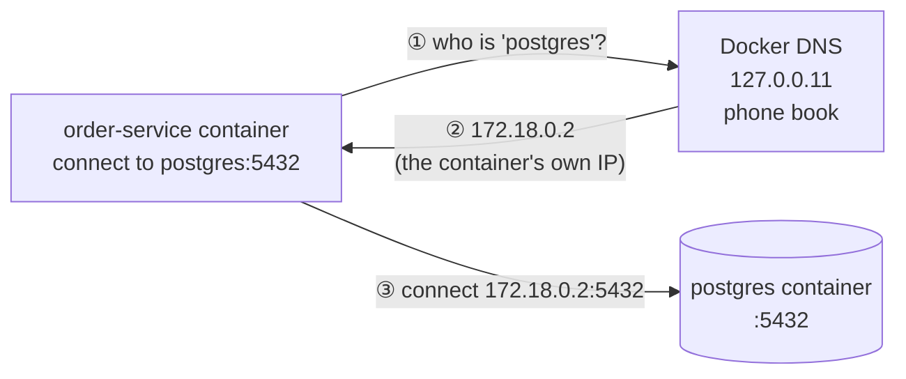
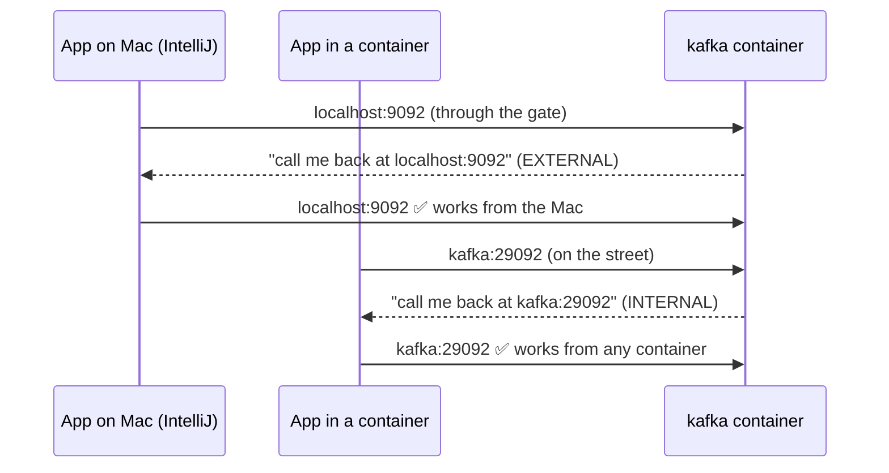
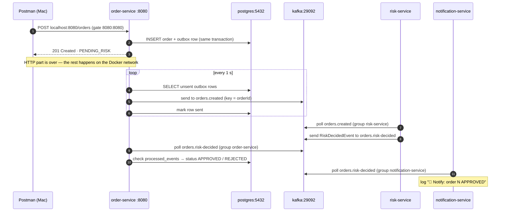
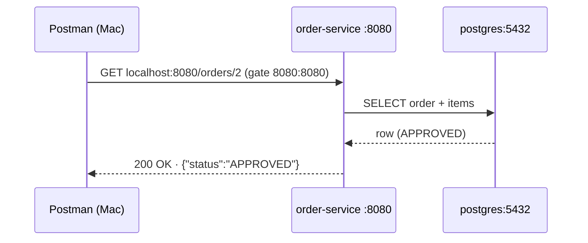

# How TradeFlow runs on Docker Compose — one order's journey

Companion to `docker-kafka-commands.md` (commands) and `kubernetes-flow.md` (same story on K8s).
Diagrams use Mermaid (GitHub / IntelliJ Markdown preview); the ASCII map works everywhere.

Start everything: `docker compose up -d --build` · Stop: `docker compose down`

---

## 1. The map (all 5 in Docker)



Same picture in plain text:

```
 YOUR MAC
 ┌─────────────┐   ┌──────────────────┐   ┌───────────────────────────┐
 │  Postman    │   │ DBeaver / psql   │   │ (apps run from IntelliJ)  │
 │ :8080       │   │ :5433            │   │ kafka at localhost:9092   │
 └──────┬──────┘   └────────┬─────────┘   └─────────────┬─────────────┘
        │ gate 8080:8080    │ gate 5433:5432            │ gate 9092:9092
 ═══════╪═══════════════════╪═══════ Docker network "tradeflow_default" (the street) ══════
        ▼                   ▼                           ▼
  ┌────────────────────┐  postgres:5432  ┌──────────────────────┐
  │ order-service:8080 │ ──────────────► │ postgres :5432       │
  │ controller, outbox,│                 └──────────────────────┘
  │ listener           │  kafka:29092    ┌──────────────────────────────────────┐
  │                    │ ──────────────► │ kafka  :9092  EXTERNAL (for the Mac) │
  └────────────────────┘                 │        :29092 INTERNAL (containers)  │
                                         │        :9093  CONTROLLER (itself)    │
  ┌────────────────────┐  kafka:29092    └──────────────────────────────────────┘
  │ risk-service       │ ──────────────►            ▲
  └────────────────────┘                            │
  ┌────────────────────┐  kafka:29092               │
  │ notification-svc   │ ───────────────────────────┘
  └────────────────────┘     (no gate: nobody on the Mac calls risk or notification)
```

**Houses on a street:** each container is a house, the Docker network is the street, the
compose **service name is the house name**, and `ports:` is a **gate** from the Mac
(left = Mac port, right = container port). Inside a house, `localhost` = that house.

---

## 2. How any internal call works (2 hops)



- **Docker's built-in DNS** (at `127.0.0.11` inside every container) knows each compose
  service name and answers with **that container's IP** on the network.
- There is **no Service IP and no switchboard** in between (that's a Kubernetes thing).
  The name points straight at one container.
- The **right side** of `ports:` is what other containers use. The **left side** (Mac port)
  doesn't exist on the street: `postgres:5432`, never `postgres:5433`.

---

## 3. Kafka's receptionist (why two listeners)

The first connection only asks *"where should I talk to you?"*. Kafka answers with its
**advertised listener** for the door you came in through, and the client reconnects there.



If a container used `localhost:9092`, it would knock on **its own house** → connection refused.
If the Mac got `kafka:29092`, it couldn't resolve that name. Hence two listeners.

---

## 4. POST /orders — create



## 5. GET /orders/{id} — read



---

## 6. Port table

| Who connects | Address used | Mac gate (`ports:`) | → Container port | Why |
|---|---|---|---|---|
| Postman (Mac) | `localhost:8080` | `8080:8080` | 8080 | call the API |
| DBeaver / psql (Mac) | `localhost:5433` | `5433:5432` | 5432 | look at the DB (5432 may be busy on the Mac) |
| App in IntelliJ (Mac) → Kafka | `localhost:9092` | `9092:9092` | 9092 EXTERNAL | dev from the IDE |
| order-service container → DB | `postgres:5432` | — | 5432 | on the street, no gate |
| all 3 app containers → Kafka | `kafka:29092` | — | 29092 INTERNAL | on the street, no gate |
| Kafka → its controller | `kafka:9093` | — | 9093 | KRaft voters `1@kafka:9093` |
| risk / notification web (8081/8082) | — | none | — | only used by K8s probes; no gate in Compose |

Where the addresses come from: `application-dev.yaml` has the **Mac** values
(`localhost:5433`, `localhost:9092`); in `docker-compose.yml` the env vars
`SPRING_DATASOURCE_URL` / `SPRING_KAFKA_BOOTSTRAP_SERVERS` **override** them with the **street** values.

## 7. Two ways we ran it

| Setup | Apps run in | DB address | Kafka address |
|---|---|---|---|
| Dev (M2–M5) | IntelliJ on the Mac | `localhost:5433` (gate) | `localhost:9092` (EXTERNAL, gate) |
| All in Docker (end of M5) | containers | `postgres:5432` (street) | `kafka:29092` (INTERNAL, street) |
| Mixed (M5 test) | order in Docker, risk+notify in IntelliJ | — | both listeners at once |

---

## 8. Docker Compose vs Kubernetes (same app, two worlds)

| | Docker Compose | Kubernetes |
|---|---|---|
| Name lookup | Docker DNS → **container IP** directly | CoreDNS → **Service IP** → kube-proxy → a pod |
| Stable name comes from | the compose **service name** (automatic) | a **Service** object you write |
| Door from the Mac | `ports: "8080:8080"` on any container | Service `type: LoadBalancer` / NodePort / Ingress, or `port-forward` |
| Settings | `environment:` | ConfigMap + `envFrom` (Secret for passwords) |
| Kafka listeners | EXTERNAL `localhost:9092` + INTERNAL `kafka:29092` | INTERNAL `kafka:29092` only (no Mac app talks to Kafka) |
| App crashes | `restart: on-failure` | Deployment replaces the pod + liveness probe |
| Ready to serve? | `depends_on` = start order only, not readiness | readiness probe |
| Several copies | awkward (`--scale`, port clashes) | `replicas: 2` |
| Machines | one | many (ours: one node) |

---

## 9. Five sentences to remember

1. Each container is a **house** on the Docker network; the **service name** is its address.
2. `ports: "LEFT:RIGHT"` is a **gate from the Mac**: left = Mac port, right = container port.
   Containers never use the left number.
3. Inside a container, **`localhost` = that container**, so containers reach each other by name
   (`postgres:5432`, `kafka:29092`).
4. Kafka needs **two listeners** because it tells clients where to call back:
   `localhost:9092` for the Mac, `kafka:29092` for containers.
5. Compose **env vars override** the yaml, so one image works both from IntelliJ and in Docker.
