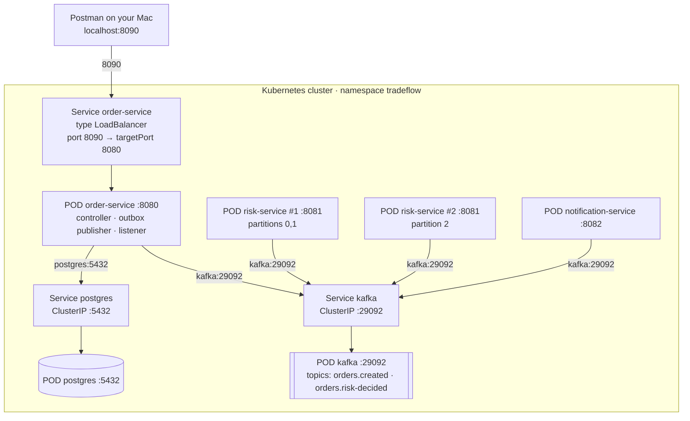
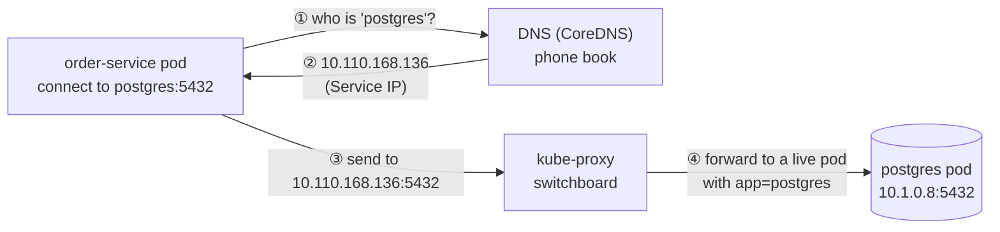
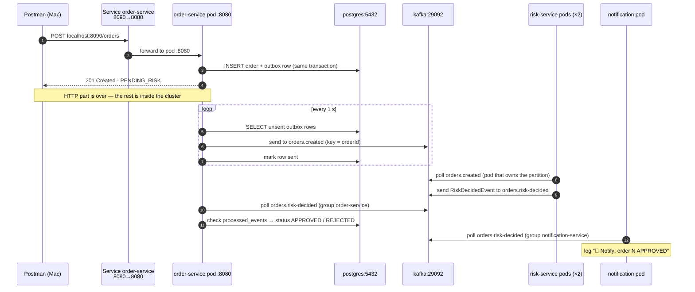
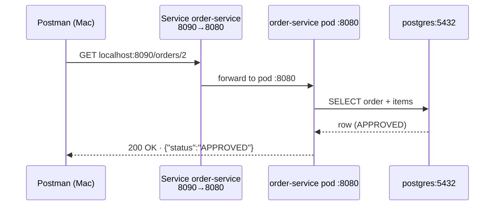

# How TradeFlow runs on Kubernetes — one order's journey

Companion to `kubernetes-commands.md`. Diagrams use Mermaid (renders on GitHub
and in IntelliJ's Markdown preview); the ASCII map below works everywhere.

---

## 1. The map



Same picture in plain text:

```
 YOUR MAC
 ┌─────────────┐
 │  Postman    │  POST/GET http://localhost:8090/orders
 └──────┬──────┘
        │ 8090
 ═══════╪═══════════════ Kubernetes cluster (namespace: tradeflow) ═════════════════════
        ▼
  ┌──────────────────────────┐
  │ Service order-service    │  type LoadBalancer   port 8090 → targetPort 8080
  └────────────┬─────────────┘
               ▼ (finds pods with label app=order-service)
  ┌──────────────────────────┐        postgres:5432        ┌─────────────────────┐
  │ POD order-service  :8080 │ ──────────────────────────► │ Service postgres    │──► POD postgres :5432
  │  controller, outbox,     │                             └─────────────────────┘
  │  RiskDecidedListener     │        kafka:29092          ┌─────────────────────┐
  │                          │ ──────────────────────────► │ Service kafka       │──► POD kafka :29092
  └──────────────────────────┘                             └─────────────────────┘
                                                                   ▲      ▲
                                    kafka:29092 (they call Kafka)  │      │
  ┌──────────────────────────┐  ┌──────────────────────────┐       │      │
  │ POD risk-service #1 :8081│  │ POD risk-service #2 :8081│ ──────┘      │
  └──────────────────────────┘  └──────────────────────────┘              │
  ┌──────────────────────────────────┐                                     │
  │ POD notification-service  :8082  │ ────────────────────────────────────┘
  └──────────────────────────────────┘
```

**Arrows show who opens the connection.** Every arrow into Kafka starts at an app:
consumers *pull*, nobody pushes into them. That's why risk and notification have no Service.

---

## 2. How any internal call works (3 hops)



- **DNS = phone book.** Turns the Service name into the Service IP. Short name works inside the
  same namespace; full name is `postgres.tradeflow.svc.cluster.local`.
- **kube-proxy = switchboard.** The Service IP is not a machine; traffic to it is forwarded to one
  live pod with the matching label (picks one when there are several).
- Pods die and come back with **new IPs**; the Service name and IP **never change**.

---

## 3. POST /orders — create



## 4. GET /orders/{id} — read



Same door as the POST, plus one DB call. No Kafka involved.

---

## 5. Port table

| Who connects | Address used | Service port | → Pod port (targetPort) | Why |
|---|---|---|---|---|
| Postman (Mac) | `localhost:8090` | 8090 (LoadBalancer) | **8080** | the only door from outside |
| order-service → DB | `postgres:5432` | 5432 | 5432 | save / read orders |
| all 3 apps → Kafka | `kafka:29092` | 29092 | 29092 | send / read events |
| Kafka → its controller | `localhost:9093` | — | 9093 | same pod, so `localhost` |
| kubelet → health probes | pod IP `:8080 / :8081 / :8082` | — | direct | probes skip the Service |

Ports change **only at a Service** (`port` → `targetPort`). Probes go straight to the pod's
own IP, which is how risk and notification get health-checked without a Service.

## 6. Service types (which door?)

| Type | Door from outside? | TradeFlow |
|---|---|---|
| ClusterIP (default) | none — pod to pod only | postgres, kafka |
| NodePort | fixed port 30000–32767 on the node | (created under our LoadBalancer: `8090:31415`) |
| LoadBalancer | real external address (Docker Desktop: `localhost`) | order-service on 8090 |
| Ingress (separate object) | one entry for many services by path/domain | not used — real-world default |

---

## 7. Five sentences to remember

1. From outside there is **one door**: the order-service LoadBalancer, `localhost:8090` → pod `8080`.
2. Inside, everyone calls **by Service name** (`postgres:5432`, `kafka:29092`): DNS → Service IP → switchboard → live pod.
3. **Kafka consumers are never called**; they connect out and pull, so risk and notification need no Service.
4. Pods come and go with **new IPs**; Service names never change, so nobody uses pod IPs.
5. Ports change **only at the Service** (`port` → `targetPort`); probes go straight to the pod.
